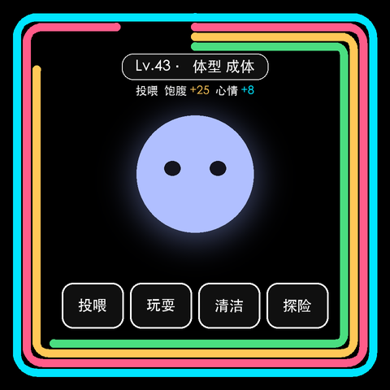

# 项目介绍 · GrokBot for Waveshare AMOLED216

> 一块会「看方向、认主人」的 AI 桌面宠物屏幕——把 M5Stack StopWatch 上大火的 GrokBot 动画，搬进微雪 2.16 寸 AMOLED 小智 AI 助手里。




## 这是什么

这是一份**第三方移植固件**，让微雪 `ESP32-S3-Touch-AMOLED-2.16` 开发板（一块 2.16 寸方形 AMOLED 触摸屏）运行 GrokBot 动画，并作为小智 AI 语音助手的可视化形象：

- 你说话时，它会用 28 种表情回应——聆听、思考、说话、提醒……
- 你把屏幕横过来、竖过来、倒过来，画面、字幕、状态栏**始终正立**；
- 它还是一只电子宠物：摸摸头、喂喂食、陪它玩，心情 / 饱腹 / 活力会变化，还会记住状态；
- 首页只保留状态栏、字幕与动画，不响应触摸；宠物玩法收进 Key3 单击进入的专属页面；
- 音频经过底层优化，对话更连贯，不再断断续续；
- 刷机不清除配网信息，开机即连，开箱即用。

它不是任何官方固件——是站在多个开源项目肩膀上的一次个人移植实验。所有引用与许可证都写在 [`THIRD_PARTY_NOTICES.md`](THIRD_PARTY_NOTICES.md) 里。

## 为什么做

M5Stack 的 StopWatch 上，GrokBot 这块「像素小怪物」屏幕很受欢迎，但它的固件只跑在 M5Stack 自家硬件上。微雪这块 2.16 寸 AMOLED 屏幕更大更清晰（480×480），却缺少这样的动态形象。

于是把两者接起来：以 `xiaozhi-esp32` 的 `dev-grokbot` 分支起步，新建微雪板型，让 GrokBot 动画在小智固件里跑起来，并解决这块板子实际暴露的问题——旋转方向反、声音卡顿、刷机后要重新配网。此后逐步升级到官方 v2.6.0 基线、固化公共 DNS 根治音频断续、恢复稳定的 AFE 唤醒词；并把 GrokBot 从单纯的显示角色做成完整养成电子宠物：六维数值、成长阶段、睡眠、探险事件、成就与 NVS 持久化，最终收进独立的宠物页面（四层同心圆角运动环 + 彩色数值反馈 + 摇一摇头晕）。逐版本的精确改动见 [docs/BOARD.md](docs/BOARD.md)。

## 它能做什么

| 特性 | 说明 |
| --- | --- |
| 🎭 **GrokBot 动画** | 28 状态 / 360×360 灰度图集，跟随小智状态实时切换；v7 起 30 FPS 满帧播放，对话时降到 15 FPS 让出资源给音频 |
| 🐾 **完整养成宠物**（v11） | 六维数值（心情/饱腹/活力/健康/清洁/乐趣）+ 等级 + 成长阶段 + 睡眠 + 探险事件 + 抚摸防刷分 + 待机小动作 + 7 项成就；NVS 保存、离线衰减、永不死亡 |
| 🎮 **四层运动环宠物页**（v20） | Key3 单击进入：等级徽章与反馈字幕在上方；心情（青）/健康（粉）/饱腹（琥珀）/清洁（绿）四层同心圆角矩形环无底轨道、未满圆头/满值闭合、四角等距，环上无属性名；互动数值按环色显示；底部四个黑白描边按钮下移，角色保持原色且动画全程连贯；点击角色抚摸、静置 1 分钟自动睡觉；摇一摇触发头晕动画 |
| 🔄 **四向自动旋转** | 板载 QMI8658 六轴 IMU 感知重力，横竖屏自动切换，状态栏 / 字幕 / 动画整体正立；直接切换、无过渡动画 |
| 🔒 **按键操作** | BOOT(GPIO0) 对话/静音/锁屏；Key3(GPIO18) 单击进出宠物页（有效电平自动检测）；SYS_OUT(GPIO16) 宠物快捷动作；v14 静音真正下发硬件音量 0 |
| 🔊 **音频优化** | I2S 中断入 IRAM、DMA 缓冲加深、播放队列 120ms→480ms、解码/输出任务绑核、Wi-Fi 省电在播放时关闭 |
| 🌐 **DNS 固化**（v8） | 联网后固定公共 DNS 并在 DHCP 完成后重设，解决 `api.tenclass.net` 解析失败导致的音频断续 |
| 📶 **保留配网** | 刷机只覆盖程序分区，保留 NVS 中的 Wi-Fi 凭据与设备 token，重启自动重连 |

## 硬件要求

- **开发板**：Waveshare ESP32-S3-Touch-AMOLED-2.16
- **主控**：ESP32-S3R8，16MB Flash / 8MB PSRAM
- **屏幕**：480×480 CO5300 QSPI AMOLED
- **触摸**：CST9217 / CST9220
- **IMU**：QMI8658（I2C，SDA=15 / SCL=14）
- **音频**：ES8311 输出 + ES7210 双麦输入
- **电源管理**：AXP2101

## 最快上手

```bash
pip3 install esptool pyserial
./tools/flash.sh                       # 刷机（保留 Wi-Fi 配网）
```

全新板子首次开机会进入配网热点 `Xiaozhi-XXXX`（`http://192.168.4.1`）。详细步骤见 [`README.md`](README.md)。

## 项目结构一览

```
firmware-src/   完整固件源码（基于 Ocean-lhy/xiaozhi-esp32 dev-grokbot）
releases/       预编译固件（整片镜像 + 分分区组件 + 校验和）
tools/          刷机 / 恢复脚本
docs/           板型说明、移植补丁、发布说明
```

## 关于署名

本项目是**移植与增强**，不是上游官方仓库。它复用了：

- `78/xiaozhi-esp32`（MIT）固件主体
- `Ocean-lhy/xiaozhi-esp32` dev-grokbot 分支（GrokBot 显示）
- `Ocean-lhy/Stopwatch-GrokBot`（动画图集设计）
- `HerbertGao/Tokenmeter`（同板型旋转映射参考）
- 以及 ESP-IDF / LVGL 等框架

完整清单、精确 commit、许可证原文见 [`THIRD_PARTY_NOTICES.md`](THIRD_PARTY_NOTICES.md)。若发现遗漏署名，欢迎开 Issue。

## 免责声明

个人实验作品，与微雪电子、M5Stack、小智官方、GrokBot 原作者均无官方关联，不提供任何担保。刷机有风险，操作前请自行备份原厂固件。本项目新增代码以 MIT 发布（见 [`LICENSE`](LICENSE)）。