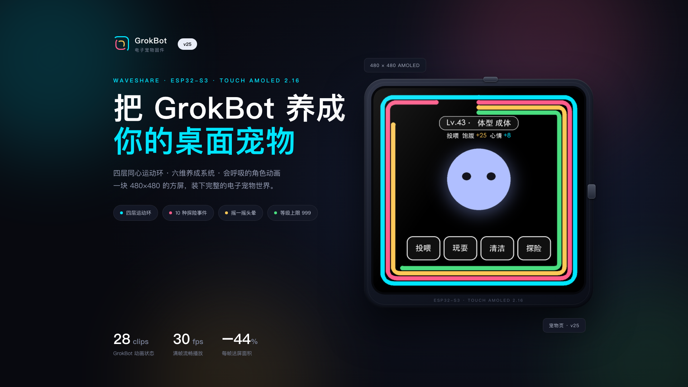
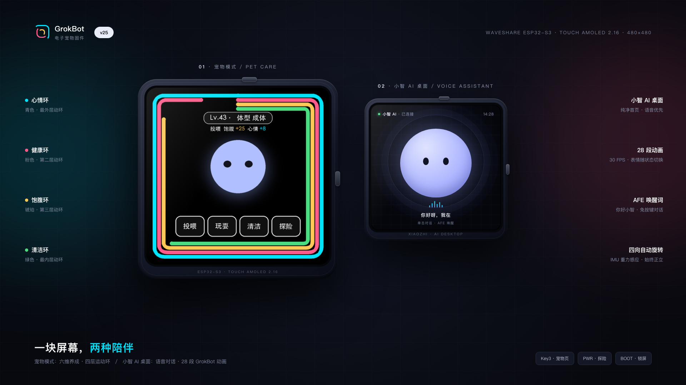

# GrokBot 桌面电子宠物 · 小智 AI 语音助手固件

> 把 GrokBot 动画角色移植到微雪 ESP32-S3-Touch-AMOLED-2.16 的第三方小智固件：一块 480×480 方屏，同时容纳纯净的 AI 语音桌面与会成长的桌面电子宠物。



*一块屏幕，两种陪伴：小智 AI 桌面与宠物模式。*



---

## 这是什么

这是一份面向 **Waveshare ESP32-S3-Touch-AMOLED-2.16** 的第三方小智 AI 固件。它基于官方 v2.6.0 基线，把 M5Stack StopWatch 上很受欢迎的 GrokBot 动画角色搬进这块 2.16 寸 AMOLED 方屏，并新增一个完整的电子宠物模式。

项目不是上游小智或 GrokBot 的官方仓库，而是移植与增强版本。所有原始代码版权归各自作者所有。

---

## 功能亮点

### 小智 AI 桌面

- 基于官方 **v2.6.0** 协议层 / MCP / OTA / 网络管理代码。
- 恢复官方 WakeNet `wn9_hiesp` **AFE 唤醒词**，可直接语音对话。
- **28 段 GrokBot 动画状态**，30 FPS 播放，表情随 idle / listening / speaking / notifying 等状态切换。
- 板载 QMI8658 IMU，**四向自动旋转**，状态栏、字幕和动画始终保持正立。
- I2S ISR / 控制函数入 IRAM、DMA 缓冲加深、播放队列 480 ms、音频解码与输出任务分核绑定，并动态关闭 Wi-Fi 省电以改善音频断续。
- 首页保持纯净，不响应触摸，所有宠物玩法都在独立页面完成。

### 电子宠物模式

- **Key3 单击**进入 / 退出宠物页；语音唤醒时自动退回主界面。
- 四层同心圆角矩形运动环：心情（青）/ 健康（粉）/ 饱腹（琥珀）/ 清洁（绿），无底色轨道，未满圆头、满值闭合。
- 六维养成：心情、饱腹、活力、健康、清洁、乐趣；带等级、成长阶段、睡眠系统和成就。
- 10 种探险事件，字幕只显示纯描述，数值变化由统一反馈行按颜色展示，不重复。
- 底部「投喂 / 玩耍 / 清洁 / 探险」四按钮，点击角色可抚摸；连续点击有防刷分冷却。
- 摇一摇设备触发头晕动画，首页与宠物页均生效，并按动画实际长度完整播放。
- 等级上限 **999**；亲密度持续增长但显示等级稳定，不会在 99 与 100+ 之间跳变。
- 宠物永不死亡；长期无人照顾会自动复活到可玩基线，状态通过 NVS 持久化并补偿离线衰减。

### v25 变更

- 等级上限改为 **999**。
- 删除 PWR 键唤醒省电：降亮度后不再有任何按键或触摸可唤醒。
- 自动关机保持 **5 分钟**：静置 60 秒降亮度，300 秒自动关机。
- 亮度只在 BOOT 长按解锁路径恢复。
- 保留 v20～v24 的全部功能与性能优化。

---

## 适配硬件

| 项目 | 参数 |
| --- | --- |
| 开发板 | Waveshare ESP32-S3-Touch-AMOLED-2.16 |
| 主控 | ESP32-S3R8，16 MB Flash / 8 MB PSRAM |
| 屏幕 | 480×480 CO5300 QSPI AMOLED |
| 触摸 | CST9217 / CST9220（I2C） |
| IMU | QMI8658（SDA=15 / SCL=14） |
| 音频 | ES8311 输出 + ES7210 双麦输入 |
| 电源管理 | AXP2101 |

---

## 刷机

使用仓库 `releases/` 目录下的整片镜像：

```text
grokbot_waveshare_amoled216_v25.bin
SHA256: 06ce6ca2f5d9ce76c57b6eaee97714c13a01230979921c07ab525801c9b452da
```

也可以直接运行仓库内的刷机脚本：

```bash
./tools/flash.sh /dev/cu.usbmodem2101
```

刷机只覆盖 bootloader、分区表、app 和 assets，**保留 0x9000 的 NVS**，因此已配网设备的 Wi-Fi 凭据、设备绑定 token 和宠物状态都会保留。首次刷入或全新板子会自动进入配网热点 `Xiaozhi-XXXX`。

---

## 按键说明

| 操作 | 效果 |
| --- | --- |
| BOOT 单击 | 对话 / 配网 |
| BOOT 长按 2 秒 | 锁屏 / 解锁 |
| Key3 单击 | 进入 / 退出电子宠物模式 |
| SYS_OUT（PWR）单击 | 宠物页探险；首页静音 |
| SYS_OUT 双击 | 宠物页睡着后唤醒 |
| SYS_OUT 长按 | 退出宠物模式 |
| 摇一摇设备 | 触发头晕动画 |

> v25 起，SYS_OUT（PWR）不再用于退出省电。

---

## 实机验证

- 固件版本：`2.6.0-grokbot-v25`
- 启动日志：`Atlas ready` / `Pet panel ready` / `Touch panel initialized` 正常，无崩溃。
- 连续多次 PWR 探险均正确触发；日志中出现 `Level up -> 110`，确认等级可超过 99。
- 性能优化：角色图集只渲染实际内容区域（252×286 / 360×360），每帧送屏面积减少约 44%，界面样式与玩法不变。

---

## 源码与素材

- 源码仓库：<https://github.com/Acrylic959/GrokBot-Waveshare-ESP32-S3-Touch-AMOLED-2.16>
- 发布说明：仓库 `docs/RELEASE_NOTES.md`
- 板型说明：仓库 `docs/BOARD.md`
- 宣传图与样机图均为 1920×1080，可编辑 HTML 源文件位于 `docs/images/promo/`。
