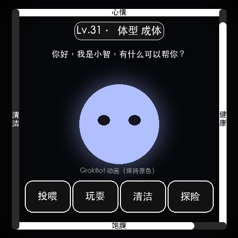

# GrokBot AMOLED216 v17

预编译固件，适用于 **Waveshare ESP32-S3-Touch-AMOLED-2.16**（ESP32-S3R8 / 16MB Flash / 8MB PSRAM / 480×480 CO5300 AMOLED）。



v16 的属性环虽然连成了圆角矩形，但实机照片显示四角仍像「拼接」出来的：独立 `lv_arc` 与直条之间有明显接缝，属性名还带深色底块。v17 按实机反馈重绘这三点，并把助手字幕移到等级 badge 下方，避免和中央角色重叠。玩法、按键、动画映射与 DNS / 配网逻辑全部保留 v16。

## 本版本变更

### 1. 只用四根属性条组成圆角矩形

删除四个独立 `lv_arc` 拼角，也不再放任何圆点。四根 bar 全部 `14px` 厚、端点 `7px` 圆角：

| 属性 | 位置 | 尺寸 |
| --- | --- | --- |
| 心情 | 上边 | 432×14 |
| 健康 | 右边（竖向） | 14×444 |
| 饱腹 | 下边 | 432×14 |
| 清洁 | 左边（竖向） | 14×444 |

四根条横跨完整宽 / 高，在四角各重叠 `14px`。同一个角上两根条的半圆端点圆心完全重合，因此看起来就是一根连续的圆角矩形边框，没有任何额外拼接件。

### 2. 属性名无底色，按填充反差变色

标签删除 `bg_color` / `bg_opa` / `radius`。填充过半时文字为黑色（落在白色填充上），未过半时为白色（落在深色轨道上），无需底块也能始终清晰：

```cpp
lv_obj_set_style_text_color(
    pet_stat_labels_[i],
    shown[i] >= 50 ? lv_color_black() : lv_color_white(), 0);
```

### 3. 字幕移到等级下方

新增 `pet_subtitle_` 标签，放在等级 badge 下方（`y=88`）、角色上方，`LV_LABEL_LONG_WRAP` 自动换行。覆写 `SetChatMessage()` / `RemoveChatMessage()` / `ClearChatMessages()`，把助手字幕镜像到这里；宠物页内不再显示底部字幕条，语音唤醒渐隐时一并隐藏。

### 4. 保留的玩法

| 操作 | 效果 | 动画 |
| --- | --- | --- |
| Key3（GPIO18）单击 | 进入 / 退出宠物页 | — |
| 投喂 / 玩耍 / 清洁 / 探险 | 对应数值变化 | `happy` / `excited` / `shy` / `surprised` |
| 点击屏幕中央角色 | 抚摸（防刷分冷却） | `playful` |
| 宠物页静置 1 分钟 | 自动入睡 | `sleeping` |
| 睡着后被唤醒 | — | `waking` |
| 语音唤醒助手 | 宠物页渐隐回主界面 | — |

中间角色始终是同一个 LVGL 图像对象，切页与动作期间动画不重建、不中断。

## 实机验证记录

启动日志（`xiaozhi/logs/grokbot_boot_v17.log`）：

```text
I (106) app_init: App version:      2.6.0-grokbot-v17
I (240) WsAmoled216Grokbot: Button GPIO18 idle=1 -> active-low
I (260) WsAmoled216Grokbot: Button GPIO16 idle=0 -> active-high
I (1868) WsAmoled216Grokbot: Electronic pet ready: 心100 饱93 力37 健100 洁99 趣98
I (1958) GrokbotDisplay: Pet panel ready (4 rounded bars form ring, contrast labels, subtitle under level)
I (4643) WifiBoard: Static DNS applied ... readback=223.5.5.5 (err 0/0/0 rb=0)
I (6193) MQTT: Connected to endpoint
```

- 无 `AP started` → NVS 保留，自动配网成功。
- 无 `ESP_ERROR_CHECK` / `Rebooting` / `abort` / E 级错误。
- 点击抚摸、静置 1 分钟自动睡眠、字幕显示仍需实机触发确认（代码中已加入对应日志与动画）。

## 刷机

```bash
pip3 install esptool pyserial
./tools/flash.sh /dev/cu.usbmodem2101                       # 保留 NVS（推荐）
./flash_grokbot_v17.sh /dev/cu.usbmodem2101                 # 工作区内专用脚本
./flash_grokbot_v17.sh /dev/cu.usbmodem2101 AUTO            # 跳过确认
```

整片镜像 `grokbot_waveshare_amoled216_v17.bin`（SHA256 `3756aad320418a6fd455a4249e4c14645f03483663a29a36c7f56c5725912043`）可直烧 0x0（会清 NVS，适合全新板子）。

## 回滚

`./flash_grokbot_v16.sh`（工作区内，保留 NVS）。`releases/` 保留 v6–v17 全部镜像与分分区组件。

## 引用

玩法与界面设计参考 DigiCat、ESP32-TamaPetchi、ESP32-C6 Desk Pet、小鲸鲸鱼娘宠物等开源项目，详见 [THIRD_PARTY_NOTICES.md](https://github.com/Acrylic959/grokbot-amoled216/blob/master/THIRD_PARTY_NOTICES.md)。本项目是第三方移植增强，非上游官方仓库。
