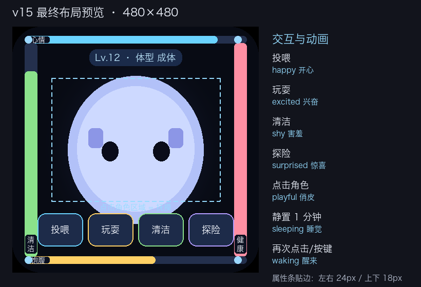

# GrokBot AMOLED216 v15

预编译固件，适用于 **Waveshare ESP32-S3-Touch-AMOLED-2.16**（ESP32-S3R8 / 16MB Flash / 8MB PSRAM / 480×480 CO5300 AMOLED）。



v14 的宠物页仍有三点可简化：属性名在条外占空间、六个按钮里抚摸和睡觉用得少、属性环离屏幕边缘还有留白。v15 按反馈重做这三点，并保留 v14 的 Key3 单击、真正硬件静音、DNS 与自动配网。

## 本版本修复 / 变更

### 1. 属性名称嵌进属性条内部

四条属性条继续贴着屏幕四边（左右 `24px`、上下 `18px`），名称不再单独放在旁边：

| 属性 | 位置 | 颜色 | 名称位置 |
| --- | --- | --- | --- |
| 心情 | 上边，432×14 | 青色 | 条内左侧 |
| 健康 | 右边，24×416，竖向 | 粉色 | 条内底部，`健/康` 竖排 |
| 饱腹 | 下边，432×14 | 琥珀色 | 条内左侧 |
| 清洁 | 左边，24×416，竖向 | 绿色 | 条内底部，`清/洁` 竖排 |

名称带半透明深色底，任意进度下都清晰可读。四角仍用圆角连接点收口成闭环。

### 2. 按钮从六个减为四个

只保留 **投喂 / 玩耍 / 清洁 / 探险**，单行四个 `88×64` 大圆角彩色描边按钮，居中放在属性环内、底部属性条上方。

按钮索引到 `PetState` 动作的映射改为 `{0, 1, 3, 4}`；`抚摸(2)` 与 `睡觉(5)` 不再占屏幕按钮。

### 3. 抚摸改为点击角色

点击屏幕中央角色区域（`x=72..408, y=96..340`，按钮点击不会穿透）触发 `PetState::Pet()`：

```text
Pet tap at (x,y) -> caress
Pet action 2 -> 舒服~ | ... | Animation -> playful
```

连续快速抚摸仍有防刷分冷却（3 次后进入冷却），睡着时点击会先自动唤醒。

### 4. 睡觉改为静置 1 分钟自动触发

进入宠物页时启动 60 秒计时；期间任何按钮或点击抚摸都会重置计时。静置满 1 分钟后自动调用 `PetState::Sleep()`：

```text
Pet auto-sleep after 60s idle: 晚安，Zzz | Animation -> sleeping
```

休眠时 `SuggestEmotion()` 返回 `sleeping`，GrokBot 播放对应动画；之后任意点击/按键会先播放 `waking` 再执行动作。

### 5. 动作与动画对应表

| 操作 | 动画 |
| --- | --- |
| 投喂 | `happy` 开心 |
| 玩耍 | `excited` 兴奋 |
| 清洁 | `shy` 害羞 |
| 探险 | `surprised` 惊喜 |
| 点击角色抚摸 | `playful` 俏皮 |
| 静置 1 分钟自动睡觉 | `sleeping` 睡觉 |
| 睡着后被唤醒 | `waking` 醒来 |

中间角色仍是同一个 LVGL 图像对象，切页与动作期间动画不重建、不中断。

## 实机验证记录

启动日志（`xiaozhi/logs/grokbot_boot_v15.log`）：

```text
I (106) app_init: App version:      2.6.0-grokbot-v15
I (240) WsAmoled216Grokbot: Button GPIO18 idle=1 -> active-low
I (260) WsAmoled216Grokbot: Button GPIO16 idle=0 -> active-high
I (1868) WsAmoled216Grokbot: Electronic pet ready: 心100 饱85 力74 健96 洁62 趣96
I (1959) GrokbotDisplay: Pet panel ready (inline stat labels, 4 buttons, tap-to-pet, auto-sleep)
I (3995) WifiBoard: Static DNS applied ... readback=223.5.5.5 (err 0/0/0)
I (5470) MQTT: Connected to endpoint
```

- 无 `AP started` → NVS 保留，自动配网成功。
- 无 `ESP_ERROR_CHECK` / `Rebooting` / `abort` / E 级错误。
- 点击抚摸与 1 分钟自动睡眠需按上述日志在实际使用时确认（代码中已加入对应日志与动画）。

## 刷机

```bash
pip3 install esptool pyserial
./flash_grokbot_v15.sh /dev/cu.usbmodem2101        # 保留 NVS（推荐）
./flash_grokbot_v15.sh /dev/cu.usbmodem2101 AUTO   # 跳过确认
```

整片镜像 `grokbot_waveshare_amoled216_v15.bin`（SHA256 `f4cefafe801032ede62e365e7219d55c342c39a253c985c24c2352c51fd19024`）可直烧 0x0（会清 NVS，适合全新板子）。

## 回滚

`./flash_grokbot_v14.sh`（工作区内，保留 NVS）。`releases/` 保留 v6–v15 全部镜像与分分区组件。

## 引用

玩法与界面设计参考 DigiCat、ESP32-TamaPetchi、ESP32-C6 Desk Pet、小鲸鲸鱼娘宠物等开源项目，详见 [THIRD_PARTY_NOTICES.md](https://github.com/Acrylic959/grokbot-amoled216/blob/master/THIRD_PARTY_NOTICES.md)。本项目是第三方移植增强，非上游官方仓库。
