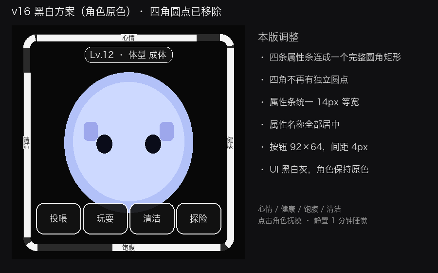

# GrokBot AMOLED216 v16

预编译固件，适用于 **Waveshare ESP32-S3-Touch-AMOLED-2.16**（ESP32-S3R8 / 16MB Flash / 8MB PSRAM / 480×480 CO5300 AMOLED）。



v15 的宠物页功能已经完整，但视觉上还有三点没到位：属性条宽度不一致、四角有孤立圆点、彩色 UI 抢了 GrokBot 角色的视觉重心。v16 按确认的预览图重绘宠物页，玩法与 v15 保持一致（Key3 单击进出、四个按钮、点击角色抚摸、静置 1 分钟自动睡觉），并保留 Key3 单击、真正硬件静音、DNS 固化与自动配网。

## 本版本变更

### 1. 黑白极简 UI，角色保持原色

属性环与按钮统一为**黑 / 白 / 灰**：底条 `0x2a2a2a`、填充与文字纯白、按钮深色底 + 白色描边。中央 GrokBot 形象**保持原始彩色**，成为画面唯一视觉焦点。

### 2. 四条属性条等宽 14px

四条边统一 `14px` 宽度，不再出现上下条与左右条粗细不一致：

| 属性 | 位置 | 尺寸 |
| --- | --- | --- |
| 心情 | 上边 | 376×14 |
| 健康 | 右边（竖向） | 14×388 |
| 饱腹 | 下边 | 376×14 |
| 清洁 | 左边（竖向） | 14×388 |

整体环放在 432×444 的容器内，贴近屏幕四边。属性名称**居中**嵌在条内：上下条水平居中，左右条竖排居中。

### 3. 四角圆点改为连续圆角矩形环

v15 四角各有一个独立圆点，v16 改为四个 `56×56` 的 LVGL `lv_arc`，与四条直边首尾相接，形成**一条完整的圆角矩形闭环**。角弧的填充比例取相邻两条属性条的**较小值**，随数值平滑变化：

```cpp
// LVGL angles: 0=right, 90=bottom, 180=left, 270=top
constexpr int kPetCornerStart[4] = {180, 270, 0, 90};
constexpr int kPetCornerPair[4][2] = {{0,3}, {0,1}, {2,1}, {2,3}};
...
const int frac = std::min(shown[kPetCornerPair[i][0]],
                          shown[kPetCornerPair[i][1]]);
lv_arc_set_angles(pet_corner_arcs_[i], kPetCornerStart[i],
                  kPetCornerStart[i] + 90 * frac / 100);
```

### 4. 按钮加大、间距收紧

底部四个按钮 **投喂 / 玩耍 / 清洁 / 探险** 改为 `92×64`，间距 `4px`，单行居中；黑白描边样式，与属性环风格一致。

### 5. 玩法保持不变

| 操作 | 效果 | 动画 |
| --- | --- | --- |
| Key3（GPIO18）单击 | 进入 / 退出宠物页 | — |
| 投喂按钮 | 饱腹 +25、心情 +8 | `happy` 开心 |
| 玩耍按钮 | 心情 +20、乐趣 +25，消耗活力/饱腹 | `excited` 兴奋 |
| 清洁按钮 | 清洁 +30、心情 +6 | `shy` 害羞 |
| 探险按钮 | 随机事件（食物 / 玩具 / 泥坑 / 交朋友等） | `surprised` 惊喜 |
| 点击屏幕中央角色 | 抚摸，心情 +4（连续 3 次进入防刷分冷却） | `playful` 俏皮 |
| 宠物页静置 1 分钟 | 自动入睡，睡眠时精力快速恢复 | `sleeping` 睡觉 |
| 睡着后被唤醒 | — | `waking` 醒来 |
| 语音唤醒助手 | 宠物页渐隐，回到主界面 | — |

中间角色始终是同一个 LVGL 图像对象，切页与动作期间动画不重建、不中断。

## 实机验证记录

启动日志（`xiaozhi/logs/grokbot_boot_v16.log`）：

```text
I (106) app_init: App version:      2.6.0-grokbot-v16
I (240) WsAmoled216Grokbot: Button GPIO18 idle=1 -> active-low
I (260) WsAmoled216Grokbot: Button GPIO16 idle=0 -> active-high
I (1868) WsAmoled216Grokbot: Electronic pet ready: 心100 饱85 力54 健94 洁0 趣98
I (1961) GrokbotDisplay: Pet panel ready (monochrome rounded ring, 4 buttons, tap-to-pet, auto-sleep)
I (4523) WifiBoard: Static DNS applied ... readback=223.5.5.5 (err 0/0/0 rb=0)
I (5901) MQTT: Connected to endpoint
```

- 无 `AP started` → NVS 保留，自动配网成功。
- 无 `ESP_ERROR_CHECK` / `Rebooting` / `abort` / E 级错误。
- 点击抚摸与 1 分钟自动睡眠需在实际使用时按日志确认（代码中已加入对应日志与动画）。

## 刷机

```bash
pip3 install esptool pyserial
./tools/flash.sh /dev/cu.usbmodem2101                       # 保留 NVS（推荐）
./flash_grokbot_v16.sh /dev/cu.usbmodem2101                 # 工作区内专用脚本
./flash_grokbot_v16.sh /dev/cu.usbmodem2101 AUTO            # 跳过确认
```

整片镜像 `grokbot_waveshare_amoled216_v16.bin`（SHA256 `bbed6038ec5aa573bc39959de5163707fc8df3d43a3a406a1a4ce05ba4f42091`）可直烧 0x0（会清 NVS，适合全新板子）。

## 回滚

`./flash_grokbot_v15.sh`（工作区内，保留 NVS）。`releases/` 保留 v6–v16 全部镜像与分分区组件。

## 引用

玩法与界面设计参考 DigiCat、ESP32-TamaPetchi、ESP32-C6 Desk Pet、小鲸鲸鱼娘宠物等开源项目，详见 [THIRD_PARTY_NOTICES.md](https://github.com/Acrylic959/grokbot-amoled216/blob/master/THIRD_PARTY_NOTICES.md)。本项目是第三方移植增强，非上游官方仓库。
