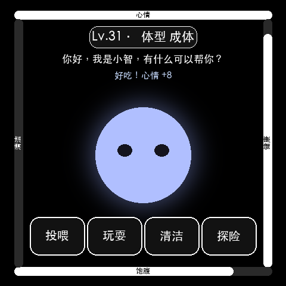

# GrokBot AMOLED216 v18

预编译固件，适用于 **Waveshare ESP32-S3-Touch-AMOLED-2.16**（ESP32-S3R8 / 16MB Flash / 8MB PSRAM / 480×480 CO5300 AMOLED）。



v17 的四根圆角条已经连成环，但预览反馈指出四处仍需调整：属性条文字偏大、左右竖条的字仍是横的、互动反馈字幕位置不对、左上角横竖条有重叠。v18 逐项修正，玩法、按键、动画映射与 DNS / 配网逻辑保持不变。

## 本版本变更

### 1. 属性条文字改用 14px 字体

本板正文字体是 `font_noto_sans_basic_20_4`，属性条只有 14px 高，20px 字会挤满整条。v18 给四个属性名显式设置 `font_noto_sans_basic_14_1`，字号与条高匹配。

### 2. 左右竖条文字旋转 90°

v17 用 `健\n康` / `清\n洁` 竖排，每个字仍是正的。v18 改为完整词语 `健康` / `清洁`，并给标签加 900（0.1° 单位，即 90°）旋转，整词横置后转成竖向，符合竖条阅读方向。

### 3. 互动反馈移到等级下方

`pet_feedback_`（例如「好吃！心情 +8」）从角色下方 `y=310` 上移到 `y=122`，与 `pet_subtitle_` 一起位于等级 badge 下方、角色上方，不再压住 GrokBot 的脸。

### 4. 四角不再重叠

v17 的横条与竖条在四角各重叠 14px，左上角能看到竖条深色端盖压住横条白填充。v18 改为：

- 横条保持完整跨度，独占四个圆角；
- 竖条从顶条下沿 `y=32` 开始，到低条上沿 `y=448` 结束；
- 二者只在边界相接，不再互相覆盖，圆角由横条自身 7px 端半径形成。

## 保留的玩法

| 操作 | 效果 | 动画 |
| --- | --- | --- |
| Key3（GPIO18）单击 | 进入 / 退出宠物页 | — |
| 投喂 / 玩耍 / 清洁 / 探险 | 对应数值变化 | `happy` / `excited` / `shy` / `surprised` |
| 点击屏幕中央角色 | 抚摸（防刷分冷却） | `playful` |
| 宠物页静置 1 分钟 | 自动入睡 | `sleeping` |
| 睡着后被唤醒 | — | `waking` |
| 语音唤醒助手 | 宠物页渐隐回主界面 | — |

中间角色始终是同一个 LVGL 图像对象，切页与动作期间动画不重建、不中断。

## 实机验证记录

启动日志（`xiaozhi/logs/grokbot_boot_v18.log`）：

```text
I (106) app_init: App version:      2.6.0-grokbot-v18
I (240) WsAmoled216Grokbot: Button GPIO18 idle=1 -> active-low
I (260) WsAmoled216Grokbot: Button GPIO16 idle=0 -> active-high
I (1868) WsAmoled216Grokbot: Electronic pet ready: 心100 饱85 力41 健97 洁0 趣98
I (1958) GrokbotDisplay: Pet panel ready (4 rounded bars form ring, contrast labels, subtitle under level)
I (4546) WifiBoard: Static DNS applied ... readback=223.5.5.5 (err 0/0/0 rb=0)
I (5991) MQTT: Connected to endpoint
```

- 无 `AP started` → NVS 保留，自动配网成功。
- 无 `ESP_ERROR_CHECK` / `Rebooting` / `abort` / E 级错误。
- 视觉细节（字号、竖排方向、四角接缝、反馈位置）请按上方预览图在实机确认。

## 刷机

```bash
pip3 install esptool pyserial
./tools/flash.sh /dev/cu.usbmodem2101                       # 保留 NVS（推荐）
./flash_grokbot_v18.sh /dev/cu.usbmodem2101                 # 工作区内专用脚本
./flash_grokbot_v18.sh /dev/cu.usbmodem2101 AUTO            # 跳过确认
```

整片镜像 `grokbot_waveshare_amoled216_v18.bin`（SHA256 `1ba374bce58d5f9cb04a5cff032d5cd33b2ecd78523ac31388bdcad0ff5797af`）可直烧 0x0（会清 NVS，适合全新板子）。

## 回滚

`./flash_grokbot_v17.sh`（工作区内，保留 NVS）。`releases/` 保留 v6–v18 全部镜像与分分区组件。

## 引用

玩法与界面设计参考 DigiCat、ESP32-TamaPetchi、ESP32-C6 Desk Pet、小鲸鲸鱼娘宠物等开源项目，详见 [THIRD_PARTY_NOTICES.md](https://github.com/Acrylic959/grokbot-amoled216/blob/master/THIRD_PARTY_NOTICES.md)。本项目是第三方移植增强，非上游官方仓库。
